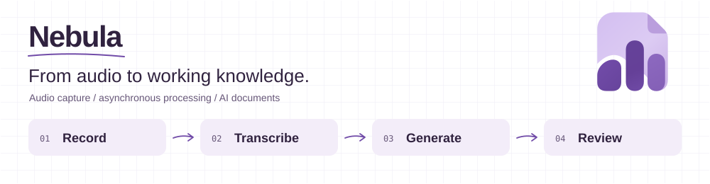
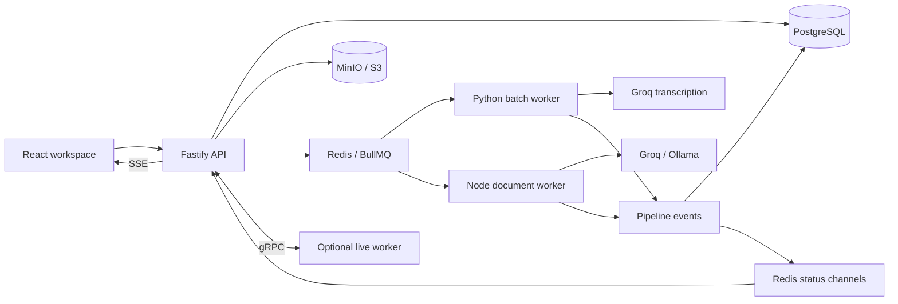

[English](README.md) · [Português brasileiro](README.pt-BR.md)

<picture>
  <source media="(prefers-color-scheme: dark)" srcset="assets/readme/header.en.dark.svg">
  <source media="(prefers-color-scheme: light)" srcset="assets/readme/header.en.light.svg">
  
</picture>

# Nebula

Turn recordings, uploaded audio and YouTube videos into searchable transcripts and structured documents. Nebula brings audio capture, asynchronous transcription and AI document generation into a single workspace for meetings, classes and interviews.

Choose a document template, follow processing as it happens, then review the result alongside the source audio. Behind that workflow are a React application, a Fastify API and independent Python workers connected through queues, events and object storage.

[Capabilities](#capabilities) · [Architecture](#architecture) · [Local setup](#local-setup) · [Development](#development) · [Technical notes](#technical-notes)

## Capabilities

| Stage | What you can do |
| --- | --- |
| Capture | Record in the browser, upload audio or import a YouTube video. Pause and resume recordings, with local recovery support. |
| Transcribe | Process uploads with Groq; use browser speech recognition or the optional gRPC worker for live transcription, depending on configuration and browser support. |
| Organize | Keep sessions in notebooks with folders and colors, and search your library. |
| Review | Edit transcripts, navigate synchronized audio and timestamps, and rename speakers when speaker data is available. |
| Generate | Use platform templates or your own instructions, adjusting tone, detail, structure and audio references. Generate documents through Groq or Ollama. |
| Reuse | Edit generated Markdown, ask questions about a session through streaming Q&A, and export transcripts as SRT, VTT, PDF, DOCX, JSON, Markdown or text. |

Local accounts use cookie-based sessions. Public templates share their instructions; session audio, transcripts and documents remain scoped to their owner.

The current interface and built-in document instructions are primarily in Brazilian Portuguese. The two READMEs provide bilingual repository documentation; application localization is separate.

## Architecture



Uploads enter `transcription-jobs`; document generation runs on `post-processing`. Pipeline events are persisted as `SessionEvent` records and published to Redis for live status updates. The batch worker handles audio preprocessing and YouTube ingestion; the optional Parakeet/faster-whisper worker handles gRPC streaming and inference.

| Layer | Technologies |
| --- | --- |
| Web | React 18, TypeScript, Vite, Tailwind CSS, Zustand, Milkdown/Crepe, Lucide |
| API | Node.js, Fastify, Prisma 7 with `@prisma/adapter-pg`, Zod, secure sessions |
| Processing | BullMQ, Python async workers, FFmpeg, yt-dlp, gRPC |
| Data | PostgreSQL 16, Redis 7, MinIO / S3 |
| AI | Groq, Ollama, optional Parakeet/faster-whisper inference |

```text
apps/
├── api/
│   ├── prisma/          # Data model, additive SQL and template seed
│   └── src/
│       ├── routes/      # Authenticated REST, SSE and WebSocket endpoints
│       ├── lib/         # Storage, models, prompts and domain logic
│       ├── jobs/        # Queues and document processing
│       └── events/      # Persisted pipeline status and publishing
├── web/src/
│   ├── api/client.ts    # Shared API client
│   ├── components/     # Capture, transcript, document and UI components
│   ├── pages/          # Login, library, session and settings
│   └── store/          # Auth, appearance and playback state
├── groq_worker/         # Batch transcription, preprocessing and ingestion
└── parakeet_worker/     # Optional streaming gRPC and GPU inference
docs/                   # Design and implementation notes
assets/readme/          # Localized light/dark SVG headers
scripts/                # Utilities and README asset generator
```

## Local setup

Use Docker Compose for the services and **pnpm 9** for workspace commands. Local Node development needs a version compatible with the installed dependencies, including Prisma 7.

### Configure the environment

Copy [`.env.example`](.env.example) to `.env` at the repository root. In PowerShell:

```powershell
Copy-Item .env.example .env
```

Replace the placeholders before starting:

| Group | Variables |
| --- | --- |
| Database / queues | `POSTGRES_USER`, `POSTGRES_PASSWORD`, `POSTGRES_DB`, `DATABASE_URL`, `REDIS_URL` |
| Storage credentials | `MINIO_ROOT_USER`, `MINIO_ROOT_PASSWORD`, `MINIO_ACCESS_KEY`, `MINIO_SECRET_KEY`, `MINIO_BUCKET` |
| Storage endpoints / events | `MINIO_PUBLIC_ENDPOINT`, `MINIO_INTERNAL_ENDPOINT`, `MINIO_ENDPOINT`, `MINIO_WEBHOOK_SECRET` |
| Authentication | `SESSION_SECRET` (at least 32 characters), `SESSION_SALT` (exactly 16 characters), `REGISTRATION_ENABLED` |
| Models / web | `GROQ_API_KEY`, `OLLAMA_URL`, `DEFAULT_MODEL`, `VITE_API_BASE_URL` |

The sample salt must be replaced: its placeholder is not 16 characters long. For a simple local MinIO setup, match the access key/secret to the root credentials, or provision a service account with bucket access. The public storage endpoint must be reachable by the browser; internal endpoints must be reachable by their services. Ollama must be reachable from the API container when selected.

### Initialize and start

For a **new, empty local database**:

```bash
pnpm install
docker compose up -d postgres redis minio
pnpm --filter api exec prisma generate
pnpm --filter api exec prisma db push
docker compose up -d --build
```

Prisma reads the root `.env` through the API configuration. For local CLI access, `DATABASE_URL` must point to PostgreSQL on `localhost`. Existing databases use additive SQL and startup helpers; review the [template policy (Portuguese)](docs/template-policy.md) before an upgrade instead of applying the fresh-database procedure.

| Service | Local address |
| --- | --- |
| Web | <http://localhost:5173> |
| API / health | <http://localhost:3333/health> |
| MinIO API / console | <http://localhost:9000> / <http://localhost:9001> |
| PostgreSQL / Redis | `localhost:5432` / `localhost:6379` |

The API creates the audio bucket if needed and provisions missing platform templates at startup. Upload transcription also requires a MinIO bucket subscription for object-created events targeting `arn:minio:sqs::API:webhook`. Compose configures the webhook target, but the bucket subscription must be configured in your MinIO installation. If an upload stalls, check this subscription and delivery to `/internal/minio-webhook`.

This is a local stack with production-style containers: Nginx serves the web build on internal port `80`, exposed as `5173`.

### First session

1. Open the web app and register an account when registration is enabled.
2. Create a session from a recording, an audio file or a YouTube link.
3. Choose a template and optionally set the title, destination and context.
4. Record or submit the source and follow processing status.
5. Review the transcript and generated document; edit, ask questions or export.

## Development

For source-mounted development with hot reload:

```bash
docker compose -f docker-compose.dev.yml up -d --build
```

To run Node applications on the host, keep infrastructure and the required Python workers available, configure host-accessible endpoints in `.env`, then run `pnpm install` and `pnpm dev`. Avoid running containerized web/API services on the same ports simultaneously.

| Task | Command |
| --- | --- |
| Build API and web | `pnpm build` |
| Build API / web separately | `pnpm --filter api build` / `pnpm --filter nebula-frontend build` |
| Document generation smoke test | `pnpm --filter api exec tsx tests/documentGeneration.test.ts` |
| Provision missing platform templates | `pnpm --filter api db:seed` |
| Validate / regenerate Prisma | `pnpm --filter api exec prisma validate` / `pnpm --filter api exec prisma generate` |
| Test Groq worker | Run `python -m pytest` from `apps/groq_worker` with its Python dependencies installed |
| API logs | `docker compose logs -f api` |
| Regenerate README headers | `python scripts/generate_readme_assets.py` |

### Optional streaming worker

The main Compose file provides a `parakeet` profile. First configure `apps/parakeet_worker/.env`, model access and the NVIDIA container runtime. The service uses host networking, so verify database/storage routing and the API's `GRPC_WORKER_HOST` for your environment. Create the external volume if absent:

```bash
docker volume create model-cache
docker compose --profile parakeet up -d --build parakeet
```

The development Compose file does not define this profile. Keep both applications' gRPC contracts synchronized when changing streaming behavior.

## Technical notes

### Document templates

Templates are database records managed through Settings and `/prompts`. Seven built-in templates cover executive briefings, articles, step-by-step guides, action plans, study material, idea maps and multiformat scripts.

Platform and third-party public templates are read-only; duplicate one to make a private, editable copy. Users can publish their own templates and select a personal default. Logical deletion preserves historical session/document references. Generation rechecks availability and never silently replaces an unavailable session template. See the [template policy (Portuguese)](docs/template-policy.md) for ownership, defaults, overrides and compatibility.

### YouTube ingestion

The creation dialog accepts watch, short-link and Shorts URLs. `/sessions/creation-options` exposes the account's duration limit; the worker checks duration before downloading. Live streams, private/protected videos and playlists without a selected video are unsupported.

Only import material you are entitled to download and process, through access permitted by the platform's terms. A publicly viewable video is not automatically authorized for download. See the [publication review](docs/legal-review.md) and [YouTube terms](https://www.youtube.com/static?template=terms).

The batch worker uses yt-dlp, FFmpeg and Node.js, retries transient downloads and preserves custom session titles. Long audio is split for Groq while retaining timestamps on the original timeline. YouTube ingestion invokes batch processing directly; its storage path is excluded from webhook transcription to avoid duplicate jobs. Long transcripts are synthesized in stages before final document generation.

### API map

| Area | Entry points |
| --- | --- |
| Accounts | `/auth/register`, `/auth/login`, `/auth/logout`, `/auth/me` |
| Sessions | `/sessions`, `/sessions/creation-options`, `/sessions/:id`, `/sessions/:id/status/stream` |
| Library | `/folders` |
| Templates | `/prompts`, `/prompts/default`, `/prompts/:id/duplicate` |
| Documents | `/sessions/:id/document`, `/sessions/:id/document/content`, `/sessions/:id/document/reprocess` |
| Transcript export | `/sessions/:id/export?format=…` |
| Audio | `/chunks/presigned-url`, `/uploads/audio/presigned-url`, `/ws/transcribe` |
| Models / preferences | `/llm/models`, `/users/config` |

The [web API client](apps/web/src/api/client.ts) and [routes](apps/api/src/routes) define full contracts and supported methods.

### Further reading

- [Design system (Portuguese)](docs/design-system.md)
- [Transcription implementation notes (Portuguese)](docs/premium-transcription.md)
- [Template policy (Portuguese)](docs/template-policy.md)

README visuals use a subtle engineering-notebook grid and sketch arrows, preserving Nebula's document/audio icon and violet palette. Local SVGs provide English/Portuguese and light/dark variants from one generator.

## License

Nebula is **source-available** under the [PolyForm Noncommercial License 1.0.0](LICENSE).

- Personal and other noncommercial use, modification and redistribution are permitted under the license conditions.
- The license expressly permits use by charitable organizations, educational institutions, public research organizations, public safety or health organizations, environmental protection organizations and government institutions, regardless of funding source.
- Commercial use outside those permissions, including ordinary internal business use, requires a separate license. Contact [LuizGabe](https://github.com/LuizGabe) to discuss permission.
- Distributions must preserve the license terms or their URL and the required notice in [NOTICE](NOTICE). Third-party components retain their [own terms](THIRD_PARTY_NOTICES.md).

The [license text](LICENSE) governs; this summary adds no restrictions or permissions. Earlier valid license grants are not revoked by this change. See the [publication and licensing review](docs/legal-review.md) for findings and unresolved questions.
