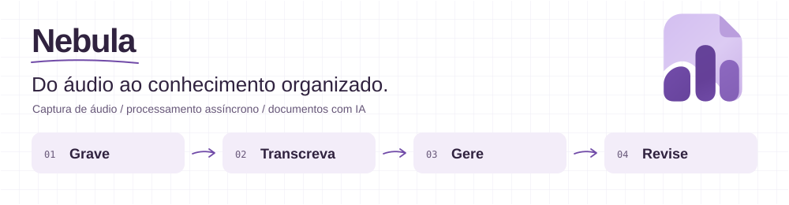
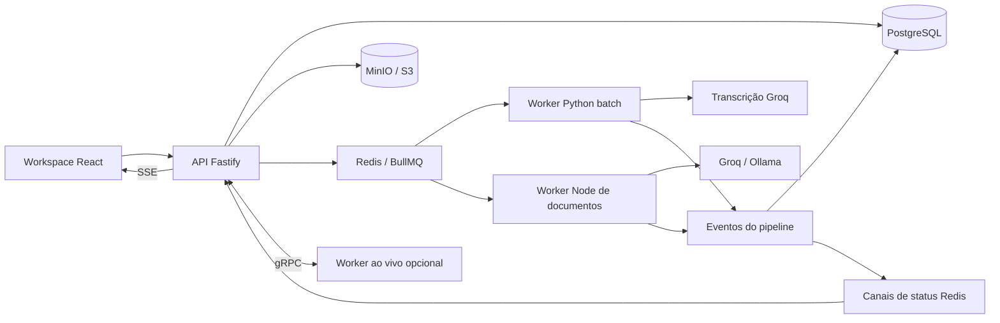

[English](README.md) · [Português brasileiro](README.pt-BR.md)

<picture>
  <source media="(prefers-color-scheme: dark)" srcset="assets/readme/header.pt-BR.dark.svg">
  <source media="(prefers-color-scheme: light)" srcset="assets/readme/header.pt-BR.light.svg">
  
</picture>

# Nebula

Transforme gravações, arquivos de áudio e vídeos do YouTube em transcrições pesquisáveis e documentos estruturados. O Nebula reúne captura de áudio, transcrição assíncrona e geração de documentos com IA em um espaço de trabalho para reuniões, aulas e entrevistas.

Escolha um template, acompanhe o processamento e revise o resultado junto do áudio original. Por trás desse fluxo estão uma aplicação React, uma API Fastify e workers Python independentes, conectados por filas, eventos e armazenamento de objetos.

[Funcionalidades](#funcionalidades) · [Arquitetura](#arquitetura) · [Ambiente local](#ambiente-local) · [Desenvolvimento](#desenvolvimento) · [Notas técnicas](#notas-técnicas)

## Funcionalidades

| Etapa | O que você pode fazer |
| --- | --- |
| Captura | Gravar pelo navegador, enviar áudio ou importar um vídeo do YouTube. Pausar e retomar gravações, com suporte à recuperação local. |
| Transcrição | Processar uploads com Groq; usar reconhecimento de fala do navegador ou o worker gRPC opcional para transcrição ao vivo, conforme a configuração e o suporte do navegador. |
| Organização | Manter sessões em cadernos com pastas e cores, e pesquisar na biblioteca. |
| Revisão | Editar transcrições, navegar pelo áudio sincronizado e pelos timestamps, e renomear falantes quando houver esses dados. |
| Geração | Usar templates da plataforma ou instruções próprias, ajustando formalidade, detalhe, estrutura e referências ao áudio. Gerar documentos com Groq ou Ollama. |
| Reutilização | Editar o Markdown gerado, fazer perguntas sobre a sessão com respostas em streaming e exportar transcrições em SRT, VTT, PDF, DOCX, JSON, Markdown ou texto. |

As contas locais usam sessões por cookies. Templates públicos compartilham suas instruções; áudio, transcrições e documentos das sessões continuam restritos ao proprietário.

A interface atual e as instruções dos templates nativos estão principalmente em português brasileiro. Os dois READMEs oferecem documentação bilíngue do repositório; a tradução da aplicação é um trabalho separado.

## Arquitetura



Uploads entram na fila `transcription-jobs`; a geração de documentos usa `post-processing`. Os eventos são persistidos como registros `SessionEvent` e publicados no Redis para atualização de status ao vivo. O worker batch cuida do pré-processamento de áudio e da importação do YouTube; o worker opcional Parakeet/faster-whisper cuida de streaming gRPC e inferência.

| Camada | Tecnologias |
| --- | --- |
| Web | React 18, TypeScript, Vite, Tailwind CSS, Zustand, Milkdown/Crepe, Lucide |
| API | Node.js, Fastify, Prisma 7 com `@prisma/adapter-pg`, Zod, sessões seguras |
| Processamento | BullMQ, workers Python assíncronos, FFmpeg, yt-dlp, gRPC |
| Dados | PostgreSQL 16, Redis 7, MinIO / S3 |
| IA | Groq, Ollama, inferência opcional com Parakeet/faster-whisper |

```text
apps/
├── api/
│   ├── prisma/          # Modelo de dados, SQL aditivo e seed de templates
│   └── src/
│       ├── routes/      # Rotas autenticadas REST, SSE e WebSocket
│       ├── lib/         # Storage, modelos, prompts e regras de domínio
│       ├── jobs/        # Filas e processamento de documentos
│       └── events/      # Persistência e publicação de status do pipeline
├── web/src/
│   ├── api/client.ts    # Cliente compartilhado da API
│   ├── components/     # Captura, transcrição, documentos e interface
│   ├── pages/          # Login, biblioteca, sessão e configurações
│   └── store/          # Estado de autenticação, aparência e reprodução
├── groq_worker/         # Transcrição batch, pré-processamento e importação
└── parakeet_worker/     # Streaming gRPC e inferência GPU opcionais
docs/                   # Notas de design e implementação
assets/readme/          # Cabeçalhos SVG traduzidos para temas claro/escuro
scripts/                # Utilitários e gerador de imagens do README
```

## Ambiente local

Use Docker Compose para os serviços e **pnpm 9** para os comandos do workspace. Para desenvolver Node localmente, use uma versão compatível com as dependências instaladas, incluindo Prisma 7.

### Configure o ambiente

Copie [`.env.example`](.env.example) para `.env` na raiz. No PowerShell:

```powershell
Copy-Item .env.example .env
```

Substitua os valores de exemplo antes de iniciar:

| Grupo | Variáveis |
| --- | --- |
| Banco / filas | `POSTGRES_USER`, `POSTGRES_PASSWORD`, `POSTGRES_DB`, `DATABASE_URL`, `REDIS_URL` |
| Credenciais de storage | `MINIO_ROOT_USER`, `MINIO_ROOT_PASSWORD`, `MINIO_ACCESS_KEY`, `MINIO_SECRET_KEY`, `MINIO_BUCKET` |
| Endpoints / eventos de storage | `MINIO_PUBLIC_ENDPOINT`, `MINIO_INTERNAL_ENDPOINT`, `MINIO_ENDPOINT`, `MINIO_WEBHOOK_SECRET` |
| Autenticação | `SESSION_SECRET` (mínimo de 32 caracteres), `SESSION_SALT` (exatamente 16 caracteres), `REGISTRATION_ENABLED` |
| Modelos / web | `GROQ_API_KEY`, `OLLAMA_URL`, `DEFAULT_MODEL`, `VITE_API_BASE_URL` |

Substitua o salt de exemplo: ele não tem 16 caracteres. Para um MinIO local simples, faça a chave e o segredo de acesso corresponderem às credenciais root, ou provisione uma conta de serviço com acesso ao bucket. O endpoint público de storage precisa estar acessível pelo navegador; os internos, pelos respectivos serviços. Se escolher Ollama, ele precisa estar acessível a partir do container da API.

### Inicialize e execute

Para um **banco local novo e vazio**:

```bash
pnpm install
docker compose up -d postgres redis minio
pnpm --filter api exec prisma generate
pnpm --filter api exec prisma db push
docker compose up -d --build
```

O Prisma lê o `.env` da raiz pela configuração da API. Para acesso local pela CLI, `DATABASE_URL` deve apontar para o PostgreSQL em `localhost`. Bancos existentes usam SQL aditivo e helpers de inicialização; consulte a [política de templates](docs/template-policy.md) antes de atualizar, em vez de aplicar o procedimento de banco novo.

| Serviço | Endereço local |
| --- | --- |
| Web | <http://localhost:5173> |
| API / saúde | <http://localhost:3333/health> |
| API / console MinIO | <http://localhost:9000> / <http://localhost:9001> |
| PostgreSQL / Redis | `localhost:5432` / `localhost:6379` |

A API cria o bucket de áudio quando necessário e provisiona templates nativos ausentes na inicialização. A transcrição de uploads também exige uma inscrição de eventos de criação de objetos no bucket MinIO, apontando para `arn:minio:sqs::API:webhook`. O Compose configura o destino do webhook, mas a inscrição do bucket precisa ser configurada na sua instalação do MinIO. Se um upload ficar parado, confira essa inscrição e a entrega para `/internal/minio-webhook`.

Essa stack é local, com containers em formato de produção: o Nginx serve o build web na porta interna `80`, exposta como `5173`.

### Primeira sessão

1. Abra a aplicação e crie uma conta quando o cadastro estiver habilitado.
2. Crie uma sessão a partir de gravação, arquivo de áudio ou link do YouTube.
3. Escolha um template e, se quiser, defina título, destino e contexto.
4. Grave ou envie a fonte e acompanhe o processamento.
5. Revise a transcrição e o documento gerado; edite, faça perguntas ou exporte.

## Desenvolvimento

Para desenvolver com código montado em volumes e hot reload:

```bash
docker compose -f docker-compose.dev.yml up -d --build
```

Para executar Node no host, mantenha a infraestrutura e os workers Python necessários disponíveis, configure endpoints acessíveis pelo host no `.env` e rode `pnpm install` e `pnpm dev`. Evite executar os serviços web/API dos containers nas mesmas portas simultaneamente.

| Tarefa | Comando |
| --- | --- |
| Build da API e web | `pnpm build` |
| Build separado da API / web | `pnpm --filter api build` / `pnpm --filter nebula-frontend build` |
| Smoke test de geração de documentos | `pnpm --filter api exec tsx tests/documentGeneration.test.ts` |
| Provisionar templates nativos ausentes | `pnpm --filter api db:seed` |
| Validar / regenerar Prisma | `pnpm --filter api exec prisma validate` / `pnpm --filter api exec prisma generate` |
| Testar worker Groq | Execute `python -m pytest` em `apps/groq_worker`, com as dependências Python instaladas |
| Logs da API | `docker compose logs -f api` |
| Regenerar cabeçalhos dos READMEs | `python scripts/generate_readme_assets.py` |

### Worker de streaming opcional

O Compose principal oferece o profile `parakeet`. Configure primeiro `apps/parakeet_worker/.env`, o acesso aos modelos e o runtime NVIDIA dos containers. O serviço usa rede do host, então confira o acesso ao banco/storage e o `GRPC_WORKER_HOST` da API para o seu ambiente. Crie o volume externo caso não exista:

```bash
docker volume create model-cache
docker compose --profile parakeet up -d --build parakeet
```

O Compose de desenvolvimento não define esse profile. Mantenha os contratos gRPC das duas aplicações sincronizados ao alterar o streaming.

## Notas técnicas

### Templates de documentos

Templates são registros do banco gerenciados em Configurações e pela API `/prompts`. Os sete templates nativos cobrem briefing executivo, artigo estruturado, guia passo a passo, plano de ação, material de estudo, mapa de ideias e roteiro multiformato.

Templates da plataforma e templates públicos de terceiros são somente leitura; duplique um deles para criar uma cópia privada e editável. Cada usuário pode publicar templates próprios e escolher um padrão pessoal. A exclusão lógica preserva referências históricas de sessões e documentos. A geração verifica novamente a disponibilidade e nunca substitui silenciosamente o template indisponível de uma sessão. Consulte a [política de templates](docs/template-policy.md) para regras de propriedade, padrão pessoal, ajustes e compatibilidade.

### Importação do YouTube

O diálogo de criação aceita URLs de vídeos, links curtos e Shorts. `/sessions/creation-options` informa o limite de duração da conta; o worker verifica a duração antes de baixar. Lives, vídeos privados/protegidos e playlists sem vídeo selecionado não são aceitos.

O worker batch usa yt-dlp, FFmpeg e Node.js, tenta novamente downloads com falhas transitórias e mantém títulos personalizados. Áudios longos são divididos para o Groq com timestamps na linha do tempo original. A importação chama diretamente o processamento batch; seu caminho no storage é excluído da transcrição por webhook para evitar jobs duplicados. Transcrições longas são sintetizadas em etapas antes da geração final do documento.

### Mapa da API

| Área | Pontos de entrada |
| --- | --- |
| Contas | `/auth/register`, `/auth/login`, `/auth/logout`, `/auth/me` |
| Sessões | `/sessions`, `/sessions/creation-options`, `/sessions/:id`, `/sessions/:id/status/stream` |
| Biblioteca | `/folders` |
| Templates | `/prompts`, `/prompts/default`, `/prompts/:id/duplicate` |
| Documentos | `/sessions/:id/document`, `/sessions/:id/document/content`, `/sessions/:id/document/reprocess` |
| Exportação de transcrição | `/sessions/:id/export?format=…` |
| Áudio | `/chunks/presigned-url`, `/uploads/audio/presigned-url`, `/ws/transcribe` |
| Modelos / preferências | `/llm/models`, `/users/config` |

O [cliente web da API](apps/web/src/api/client.ts) e as [rotas](apps/api/src/routes) definem os contratos completos e métodos disponíveis.

### Outras leituras

- [Sistema de design](docs/design-system.md)
- [Notas de implementação da transcrição](docs/premium-transcription.md)
- [Política de templates](docs/template-policy.md)

Os visuais dos READMEs usam quadriculado discreto de caderno de engenharia e setas em esboço, preservando o ícone de documento/áudio e a paleta violeta do Nebula. SVGs locais oferecem variantes em inglês/português e temas claro/escuro a partir de um único gerador.

## Licença

O pacote da API declara ISC nos [metadados do pacote](apps/api/package.json). O repositório ainda não tem um arquivo de licença separado.
